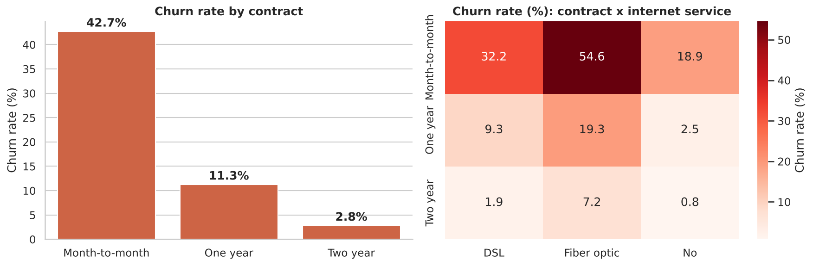
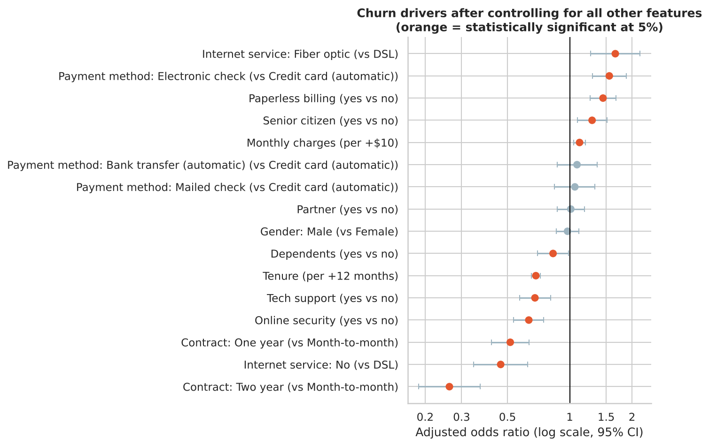
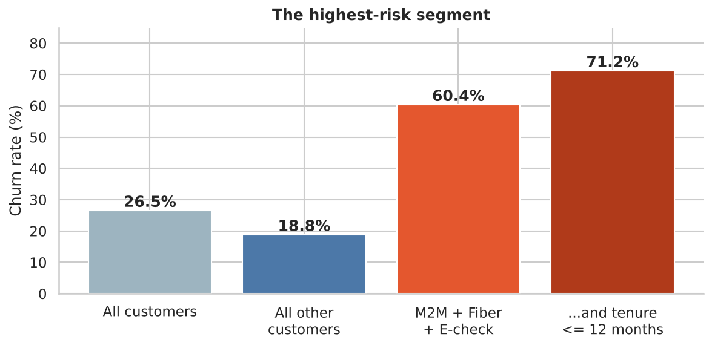

# SWYNEX-Exploratory-Data-Analysis

Task 2 of the SWYNEX Technologies Data Science Internship: exploratory data analysis (EDA) on the dataset prepared in Task 1 ([SWYNEX-Data-Preparation](#)).

**Dataset:** IBM Telco Customer Churn, cleaned (7,043 customers, 21 columns, 0 missing values).
**Business question:** Which customers are likely to cancel, and what should the business and a future model do about it?
**Start here:** [`reports/executive_summary.md`](reports/executive_summary.md) (one page) · [`notebooks/02_exploratory_data_analysis.ipynb`](notebooks/02_exploratory_data_analysis.ipynb) (full analysis, run top to bottom, outputs included)

## Headline
26.5% of customers churn, and the loss is concentrated: **month-to-month + fiber optic + electronic-check customers are 18.6% of the base but 42.2% of all churners (60.4% churn rate) and 49% of lost monthly revenue.** A plain logistic regression on the EDA features reaches ROC-AUC 0.84 and PR-AUC 0.65 (chance 0.27).

## Key insights
Rates are raw churn rates; the last column is the effect after controlling for all other features (logistic regression).

| # | Insight | Evidence | After controls |
|---|---|---|---|
| 1 | **Contract type is the strongest driver** | 42.7% vs 11.3% vs 2.8% (month-to-month / 1 yr / 2 yr); month-to-month is 55% of customers but 89% of churners | Two-year: OR 0.26 |
| 2 | **First six months are the danger zone** | 52.9% churn at 0-6 months vs 9.5% beyond 48; median churner tenure 10 vs 38 months | OR 0.69 per extra year |
| 3 | **Fiber optic churns 2x DSL, independent of contract** | 41.9% vs 19.0%; 54.6% vs 32.2% within month-to-month | OR 1.66 |
| 4 | **Security and tech-support add-ons go with lower churn** | 14.6% vs 41.8% (security); 15.2% vs 41.6% (support); streaming add-ons ~no effect | OR 0.63 / 0.68 |
| 5 | **Electronic check and paperless billing add risk** | 45.3% vs 15-19% other methods; 33.6% vs 16.3% paperless | OR 1.55 / 1.45 |
| 6 | **Churners pay more and hold ~30% of recurring revenue** | $74.44 vs $61.27 mean bill; $139K of $456K monthly revenue | OR 1.12 per +$10 |
| 7 | **One segment concentrates the problem** | M2M + fiber + e-check: 60.4% churn, 42.2% of churners, 49% of lost revenue | n/a |
| 8 | **Gender and partner status add nothing; seniors add risk** | Gender 26.9% vs 26.2% (p = 0.49); partner gap vanishes after controls | Gender OR 0.98, partner OR 1.01, senior OR 1.28 |





## Methodology
1. Data quality: missing values, duplicates, IQR outliers, consistency checks.
2. Univariate and bivariate analysis by churn, with segment churn rates.
3. **Statistical validation:** chi-square and Mann-Whitney tests, effect sizes (Cramér's V, rank-biserial), Wilson 95% confidence intervals.
4. **Confounder control:** multivariable logistic regression with adjusted odds ratios and confidence intervals.
5. **Segment analysis:** high-risk segment size, churn share and revenue at stake.
6. **Predictive-signal check:** cross-validated logistic regression baseline, precision-recall and cumulative gains.

## Recommendations
**Business:** target the high-risk segment first with annual-contract offers; build an early-life programme for months 0-6; investigate the fiber optic experience; test security and support bundles; promote autopay.
**Modelling:** stratified splits and PR-AUC/recall (26.5% churn); drop `gender` and `customer_id`; handle `tenure` / `total_charges` collinearity (r = 0.83); test a contract x internet-service interaction; beat the logistic baseline with gradient boosting; tune the threshold against campaign cost.

## Project structure
```
SWYNEX-Exploratory-Data-Analysis/
├── data/
│   ├── telco_churn_clean.csv        # output of Task 1
│   └── DATA_DICTIONARY.md
├── notebooks/02_exploratory_data_analysis.ipynb
├── src/eda_utils.py                 # Wilson CI, Cramér's V, rate tables
├── tests/test_eda_utils.py          # 6 unit tests
├── reports/
│   ├── executive_summary.md
│   └── figures/                     # 13 exported charts
├── requirements.txt
├── pytest.ini
└── README.md
```

## How to run
```bash
pip install -r requirements.txt
pytest                                                   # helper unit tests
jupyter notebook notebooks/02_exploratory_data_analysis.ipynb
```

## Limitations
Single static snapshot with no time dimension: findings are associations, not causal effects, and drift or leakage cannot be assessed. Retention actions should be validated with controlled experiments.

**Stack:** Python, pandas, NumPy, matplotlib, seaborn, SciPy, statsmodels, scikit-learn.
